# 基于springboot的招聘系统的设计与实现--论文

> 🎓 **计算机毕业设计 · 基于springboot的招聘系统的设计与实现--论文**
>
> 本仓库只放**项目介绍 + 运行截图**（截图是站点带水印的原图，存在仓库 `images/` 里）。
>
> 👉 **完整可运行源码 / 数据库脚本 / 部署文档：[点我获取](https://geekcode.top/archives/%E5%9F%BA%E4%BA%8Espringboot%E7%9A%84%E6%8B%9B%E8%81%98%E7%B3%BB%E7%BB%9F%E7%9A%84%E8%AE%BE%E8%AE%A1%E4%B8%8E%E5%AE%9E%E7%8E%B0-%E8%AE%BA%E6%96%87?utm_source=github)**
>
> 💬 咨询微信：**ir9372**　|　🌐 更多项目：[极客代码 geekcode.top](https://geekcode.top/?utm_source=github)
>
> 📌 项目详情页：<https://geekcode.top/archives/%E5%9F%BA%E4%BA%8Espringboot%E7%9A%84%E6%8B%9B%E8%81%98%E7%B3%BB%E7%BB%9F%E7%9A%84%E8%AE%BE%E8%AE%A1%E4%B8%8E%E5%AE%9E%E7%8E%B0-%E8%AE%BA%E6%96%87?utm_source=github>

<table><td width="230" align="center"> <b>扫码加微信 ir9372</b></td><td valign="middle">📦 源码 = 项目介绍 + 全部运行截图 + 数据库 + 部署文档 👉 点上方任意截图，直接跳到 <b>极客代码 geekcode.top</b> 详情页</td></table>

---

<h1>基于springboot的招聘系统的设计与实现--论文</h1>
<h2>项目概述</h2>

本项目旨在设计并实现一个基于 Spring Boot 框架的在线招聘管理系统，以解决传统招聘流程中信息分散、管理效率低下的问题。系统采用前后端分离架构，前端使用 Vue.js 构建用户界面，后端基于 Spring Boot、MyBatis-Plus 及 Apache Shiro 实现业务逻辑与权限控制。核心功能涵盖企业入驻与管理、招聘信息发布、岗位类型分类、在线应聘记录追踪、新闻公告发布以及用户留言反馈等模块。适用人群包括求职者、招聘企业及系统管理员。通过数字化手段优化人岗匹配流程，提升招聘信息的透明度与交互性，为双方提供高效、便捷的求职与招聘服务平台。

<h2>技术架构</h2>

系统采用经典的前后端分离架构模式，确保高内聚低耦合的开发与维护特性。

<strong>后端架构：</strong>
基于 Java 语言开发，核心框架选用 Spring Boot，利用其自动配置和起步依赖特性快速搭建应用基础。持久层采用 MyBatis-Plus 框架，在 MyBatis 基础上增强了 CRUD 操作能力，简化了数据库交互代码。安全认证与授权模块集成 Apache Shiro，实现细粒度的访问控制与会话管理。数据库选用 MySQL，存储结构清晰，支持事务处理。

<strong>前端架构：</strong>
前端采用 Vue.js 框架构建单页应用（SPA），通过 Axios 与后端 RESTful API 进行数据交互。界面布局响应式设计，适配不同终端展示需求。

<strong>核心技术选型理由：</strong>

<ol>
<li><strong>Spring Boot</strong>：生态成熟，社区活跃，便于集成各类中间件，降低运维复杂度。</li>
<li><strong>MyBatis-Plus</strong>：相比原生 MyBatis，大幅减少 XML 配置文件编写，提高开发效率，同时保留 SQL 灵活性。</li>
<li><strong>Apache Shiro</strong>：轻量级且强大的安全框架，易于整合到 Spring 项目中，能有效保障系统安全性。</li>
<li><strong>Vue.js</strong>：渐进式 JavaScript 框架，组件化开发模式利于复用与维护，虚拟 DOM 技术提升渲染性能。</li>
</ol>

<a href="https://geekcode.top/archives/%E5%9F%BA%E4%BA%8Espringboot%E7%9A%84%E6%8B%9B%E8%81%98%E7%B3%BB%E7%BB%9F%E7%9A%84%E8%AE%BE%E8%AE%A1%E4%B8%8E%E5%AE%9E%E7%8E%B0-%E8%AE%BA%E6%96%87?utm_source=github" title="查看完整源码">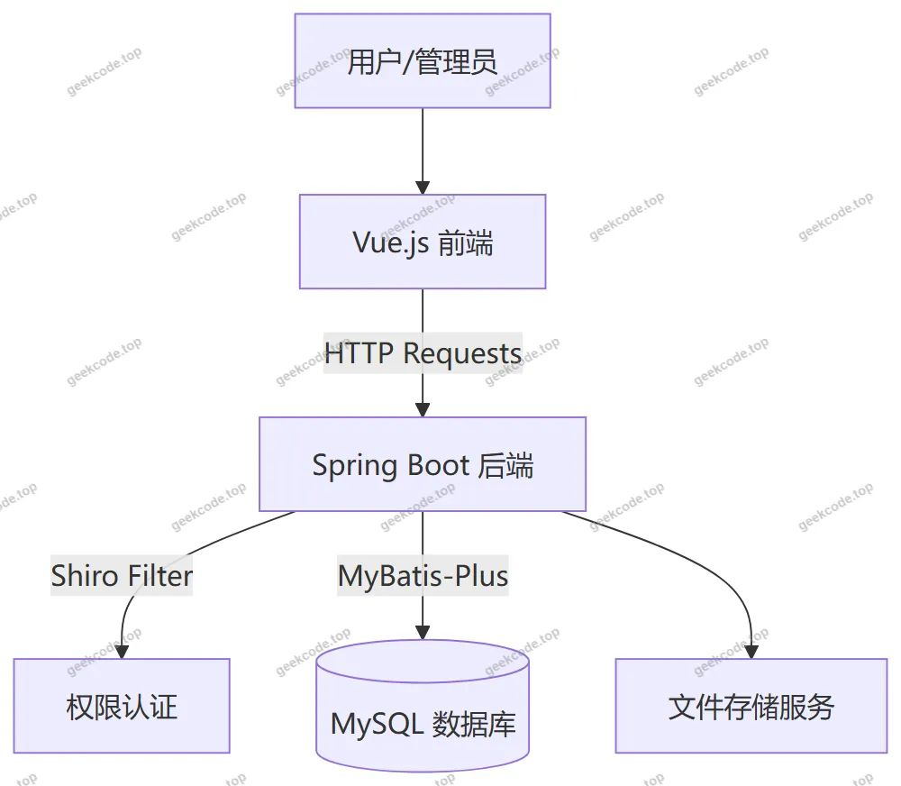</a>

<h2>功能模块</h2>

根据源码 Controller 列表及截图功能分析，系统主要划分为前台用户端和后台管理端两大模块。

<h3>前台用户端功能</h3>

前台面向普通用户（求职者）及访客，提供信息浏览与交互服务。

<ol>
<li><strong>首页展示</strong>：聚合展示最新招聘信息、企业新闻及热门岗位推荐，作为流量入口。</li>
<li><strong>企业中心</strong>：</li>
</ol>
<ul>
<li><strong>企业列表</strong>：展示已入驻企业的详细信息，包括简介、规模等。</li>
<li><strong>企业详情</strong>：查看特定企业的招聘动态及联系方式。</li>
</ul>
<ol start="3">
<li><strong>招聘信息管理</strong>：</li>
</ol>
<ul>
<li><strong>职位列表</strong>：按条件筛选和浏览各类招聘岗位。</li>
<li><strong>职位详情</strong>：查看具体岗位职责、任职要求及薪资范围。</li>
<li><strong>在线应聘</strong>：用户提交简历或意向，生成应聘记录。</li>
</ul>
<ol start="4">
<li><strong>岗位类型导航</strong>：通过 <code>/gangweileixing</code> 路由相关接口，支持按行业或职能分类检索职位。</li>
<li><strong>新闻资讯</strong>：</li>
</ol>
<ul>
<li><strong>招聘新闻</strong>：浏览 <code>/news</code> 相关的行业动态、政策解读文章。</li>
<li><strong>公告列表</strong>：查看平台发布的官方通知。</li>
</ul>
<ol start="6">
<li><strong>个人中心</strong>：</li>
</ol>
<ul>
<li><strong>基本信息维护</strong>：修改个人资料。</li>
<li><strong>我的收藏</strong>：查看收藏的企业或职位（对应 <code>StoreupController</code>）。</li>
<li><strong>应聘记录</strong>：查询历史投递状态（对应 <code>YingpinjiluController</code>）。</li>
</ul>
<ol start="7">
<li><strong>留言反馈</strong>：</li>
</ol>
<ul>
<li><strong>意见反馈</strong>：用户向管理员提交建议或投诉（对应 <code>MessagesController</code>）。</li>
</ul>
<h3>后台管理端功能</h3>

后台面向系统管理员，负责全局数据管理与业务审核。

<ol>
<li><strong>系统登录</strong>：基于 Shiro 的安全认证入口。</li>
<li><strong>企业信息管理 (<code>/qiye</code>)</strong>：</li>
</ol>
<ul>
<li>新增、编辑、删除企业资料。</li>
<li>审核企业资质，管理企业账号状态。</li>
</ul>
<ol start="3">
<li><strong>招聘信息管理 (<code>/zhaopinxinxi</code>)</strong>：</li>
</ol>
<ul>
<li>发布、更新、下架招聘职位。</li>
<li>关联指定企业与岗位类型。</li>
</ul>
<ol start="4">
<li><strong>岗位类型管理 (<code>/gangweileixing</code>)</strong>：</li>
</ol>
<ul>
<li>维护招聘行业的分类标签，如“技术类”、“市场类”等。</li>
</ul>
<ol start="5">
<li><strong>用户管理 (<code>/yonghu</code>)</strong>：</li>
</ol>
<ul>
<li>查看注册用户列表。</li>
<li>重置密码、禁用/启用账号。</li>
</ul>
<ol start="6">
<li><strong>应聘记录管理 (<code>/yingpinjilu</code>)</strong>：</li>
</ol>
<ul>
<li>查看所有用户的投递情况。</li>
<li>统计招聘转化率，辅助数据分析。</li>
</ul>
<ol start="7">
<li><strong>新闻公告管理 (<code>/news</code>)</strong>：</li>
</ol>
<ul>
<li>发布和管理招聘相关新闻文章。</li>
</ul>
<ol start="8">
<li><strong>留言反馈管理 (<code>/messages</code>)</strong>：</li>
</ol>
<ul>
<li>查看用户提交的留言。</li>
<li>回复或处理用户反馈。</li>
</ul>
<ol start="9">
<li><strong>系统配置 (<code>/config</code>)</strong>：</li>
</ol>
<ul>
<li>管理轮播图、网站名称、Logo 等全局参数。</li>
</ul>
<ol start="10">
<li><strong>文件管理</strong>：</li>
</ol>
<ul>
<li>通过 <code>FileController</code> 上传图片、文档等非结构化数据。</li>
</ul>
<h2>用户角色与权限</h2>

系统基于 Apache Shiro 实现权限控制，主要包含两类角色：普通用户（求职者）和系统管理员。

<h3>1. 普通用户 (Yonghu)</h3>
<ul>
<li><strong>身份定义</strong>：注册并登录系统的求职者。</li>
<li><strong>权限范围</strong>：</li>
<li><strong>浏览权限</strong>：可访问前台所有公开页面，包括首页、企业列表、招聘信息、新闻公告、岗位类型列表。</li>
<li><strong>操作权限</strong>：</li>
<li>对感兴趣的企业或职位进行<strong>收藏</strong>。</li>
<li>提交<strong>应聘申请</strong>，生成应聘记录。</li>
<li>在<strong>个人中心</strong>查看自己的应聘记录和收藏列表。</li>
<li>提交<strong>留言反馈</strong>给管理员。</li>
<li>修改个人基本信息和密码。</li>
<li><strong>限制</strong>：无法访问后台管理路由（如 <code>/admin</code> 相关路径），无权增删改查核心业务数据（如企业、职位本身），仅能读取和操作与自己相关的数据。</li>
</ul>
<h3>2. 系统管理员 (Admin/Users)</h3>
<ul>
<li><strong>身份定义</strong>：拥有最高权限的平台运营人员。</li>
<li><strong>权限范围</strong>：</li>
<li><strong>全量数据管理</strong>：可对以下实体进行完整的 CRUD（增删改查）操作：</li>
<li>企业信息 (<code>Qiye</code>)</li>
<li>招聘信息 (<code>Zhaopinxinxi</code>)</li>
<li>岗位类型 (<code>Gangweileixing</code>)</li>
<li>新闻公告 (<code>News</code>)</li>
<li>用户账户 (<code>Yonghu</code>)</li>
<li>应聘记录 (<code>Yingpinjilu</code>)</li>
<li>留言反馈 (<code>Messages</code>)</li>
<li><strong>系统配置</strong>：管理全局配置文件 (<code>Config</code>)，如上传文件、设置站点参数。</li>
<li><strong>审核与控制</strong>：有权审核企业资质，处理违规内容，回复用户留言，管理用户状态。</li>
<li><strong>访问入口</strong>：专属后台管理界面，需通过登录验证方可进入。</li>
</ul>
<h2>项目特色与创新点</h2>
<ol>
<li>
<strong>闭环招聘业务流程</strong>：
   不同于简单的信息发布板，本系统实现了从“岗位浏览 -&gt; 收藏关注 -&gt; 在线应聘 -&gt; 记录追踪”的完整业务闭环。通过 <code>Yingpinjilu</code>（应聘记录）和 <code>Storeup</code>（收藏）模块，增强了用户粘性和平台数据的完整性，使招聘过程可追溯、可统计。

</li>
<li>
<strong>灵活的多维度检索体系</strong>：
   引入 <code>Gangweileixing</code>（岗位类型）作为独立的管理维度，结合 <code>Qiye</code>（企业）和 <code>Zhaopinxinxi</code>（招聘信息），构建了多维度的索引结构。用户可以通过行业、企业类型等多种组合条件精准定位职位，提升了人岗匹配的效率和准确性。

</li>
<li>
<strong>安全的权限隔离机制</strong>：
   深度集成 Apache Shiro，实现了严格的角色权限隔离。前台用户与后台管理员的数据视图完全分离，有效防止越权访问。特别是在敏感操作（如用户管理、数据删除）上，确保了系统数据的安全性与稳定性。

</li>
<li>
<strong>高效的开发与维护体验</strong>：
   采用 MyBatis-Plus 替代传统 MyBatis，显著减少了样板代码，使得开发者能更专注于业务逻辑的实现。前后端分离架构使得 UI 迭代与后端逻辑升级互不干扰，提高了系统的可扩展性和后期维护效率。

</li>
</ol>
<h2>部署环境</h2>

为确保系统正常运行，需准备以下软硬件环境：

<strong>硬件环境：</strong>

<ul>
<li>CPU: Intel Core i5 及以上或同等性能处理器</li>
<li>内存: 8GB RAM 及以上</li>
<li>硬盘: 至少 50GB 可用空间（用于存储日志、数据库及上传文件）</li>
</ul>

<strong>软件环境：</strong>

<ul>
<li><strong>操作系统</strong>: Windows 10/11, Linux (CentOS 7+, Ubuntu 18.04+) 或 macOS</li>
<li><strong>JDK</strong>: Java Development Kit 1.8 或更高版本（推荐 JDK 1.8，兼容性好）</li>
<li><strong>数据库</strong>: MySQL 5.7 或 MySQL 8.0</li>
<li>需创建专用数据库实例，字符集建议设置为 <code>utf8mb4</code> 以支持中文及特殊符号。</li>
<li><strong>服务器容器</strong>: Tomcat 8.5+ （若打包为 WAR）或内置 Tomcat（若打包为 JAR，Spring Boot 默认行为）</li>
<li><strong>前端运行环境</strong>: Node.js v14.x 或更高版本</li>
<li>用于编译 Vue.js 前端资源。</li>
<li>包管理器：npm 或 yarn。</li>
<li><strong>其他工具</strong>:</li>
<li>Git: 用于代码版本控制。</li>
<li>Maven: 用于后端项目依赖管理及构建。</li>
</ul>

<strong>启动步骤简述：</strong>

<ol>
<li>安装并启动 MySQL，导入项目提供的 <code>.sql</code> 初始化脚本。</li>
<li>修改后端 <code>application.yml</code> 中的数据库连接 URL、用户名和密码。</li>
<li>使用 Maven 命令 <code>mvn clean package</code> 打包后端项目，或通过 IDE 直接运行主启动类。</li>
<li>进入前端目录，执行 <code>npm install</code> 安装依赖，随后执行 <code>npm run serve</code> 启动开发服务器或 <code>npm run build</code> 生成静态文件部署至 Nginx/Tomcat。</li>
</ol>
<h2>五、技术特性</h2>
<ul>
<li>前后端集成部署，前端资源打包至后端 static 目录</li>
<li>使用 MyBatis-Plus 简化数据访问层开发</li>
<li>集成 Shiro 权限框架实现角色权限控制</li>
</ul>
<h2>六、功能模块截图</h2>
<h3>前台用户端</h3>
<h4>前台-岗位类型列表</h4>

<a href="https://geekcode.top/archives/%E5%9F%BA%E4%BA%8Espringboot%E7%9A%84%E6%8B%9B%E8%81%98%E7%B3%BB%E7%BB%9F%E7%9A%84%E8%AE%BE%E8%AE%A1%E4%B8%8E%E5%AE%9E%E7%8E%B0-%E8%AE%BA%E6%96%87?utm_source=github" title="查看完整源码">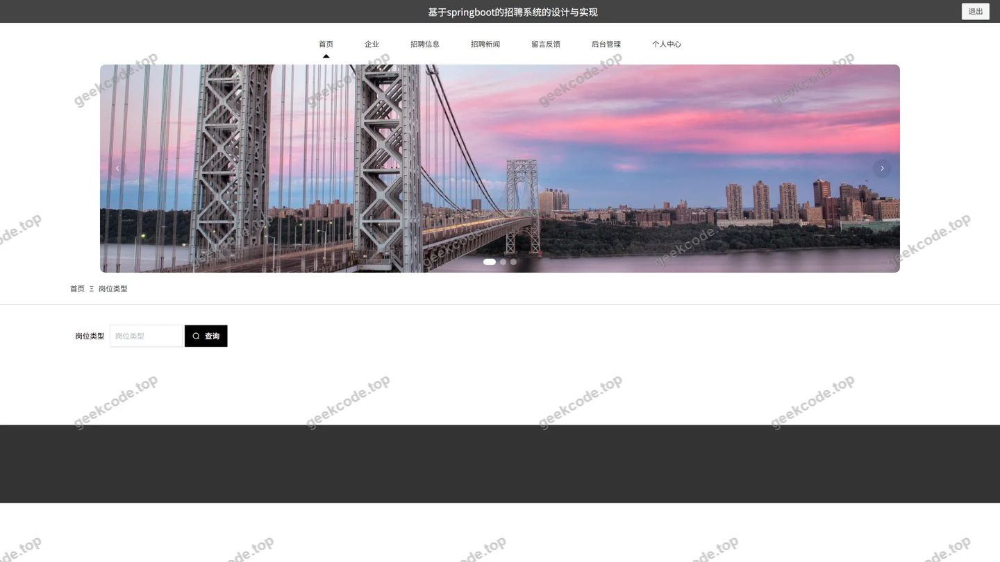</a>

<h4>前台-留言反馈列表</h4>

<a href="https://geekcode.top/archives/%E5%9F%BA%E4%BA%8Espringboot%E7%9A%84%E6%8B%9B%E8%81%98%E7%B3%BB%E7%BB%9F%E7%9A%84%E8%AE%BE%E8%AE%A1%E4%B8%8E%E5%AE%9E%E7%8E%B0-%E8%AE%BA%E6%96%87?utm_source=github" title="查看完整源码">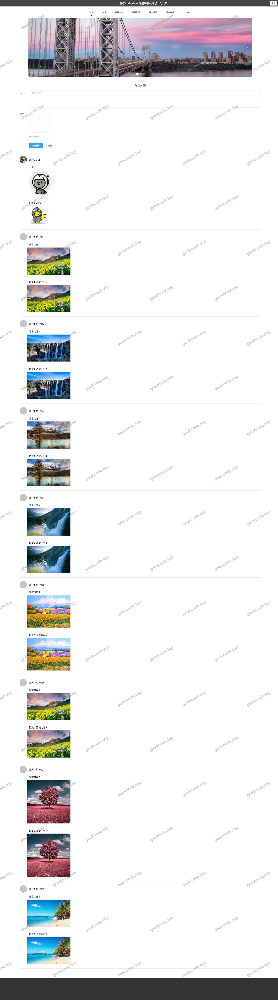</a>

<h4>前台-企业列表</h4>

<a href="https://geekcode.top/archives/%E5%9F%BA%E4%BA%8Espringboot%E7%9A%84%E6%8B%9B%E8%81%98%E7%B3%BB%E7%BB%9F%E7%9A%84%E8%AE%BE%E8%AE%A1%E4%B8%8E%E5%AE%9E%E7%8E%B0-%E8%AE%BA%E6%96%87?utm_source=github" title="查看完整源码">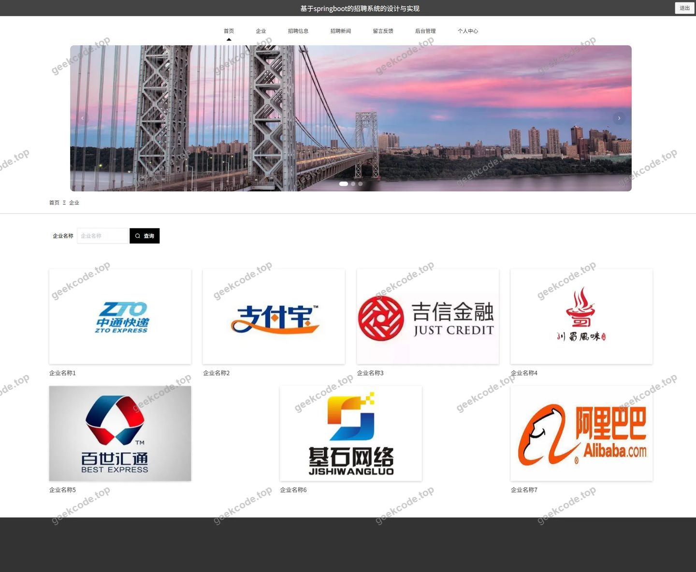</a>

<h4>前台-收藏列表</h4>

<a href="https://geekcode.top/archives/%E5%9F%BA%E4%BA%8Espringboot%E7%9A%84%E6%8B%9B%E8%81%98%E7%B3%BB%E7%BB%9F%E7%9A%84%E8%AE%BE%E8%AE%A1%E4%B8%8E%E5%AE%9E%E7%8E%B0-%E8%AE%BA%E6%96%87?utm_source=github" title="查看完整源码">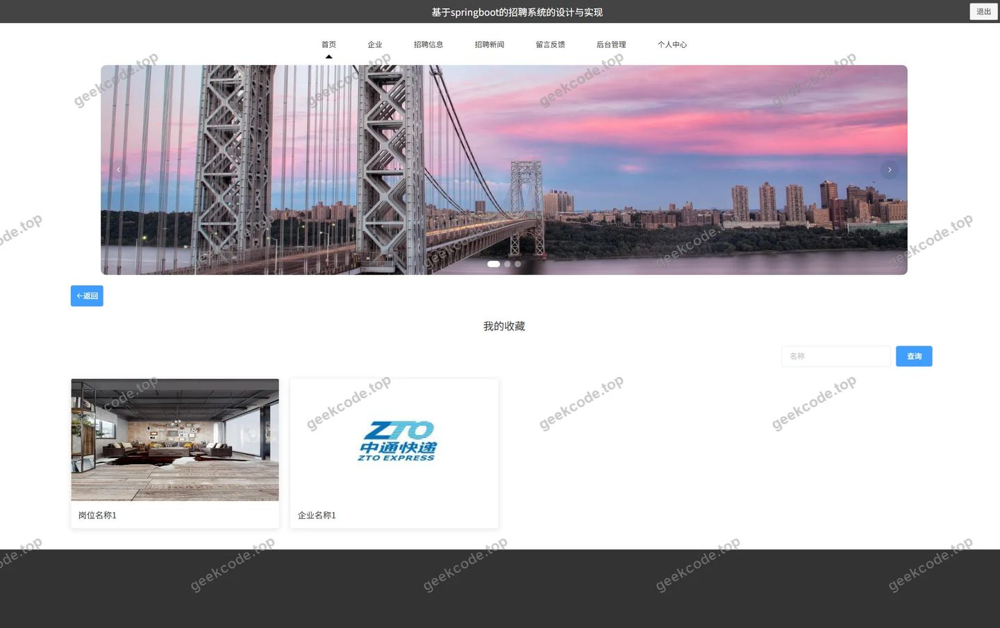</a>

<h4>前台-应聘记录列表</h4>

<h4>前台-招聘信息列表</h4>

<a href="https://geekcode.top/archives/%E5%9F%BA%E4%BA%8Espringboot%E7%9A%84%E6%8B%9B%E8%81%98%E7%B3%BB%E7%BB%9F%E7%9A%84%E8%AE%BE%E8%AE%A1%E4%B8%8E%E5%AE%9E%E7%8E%B0-%E8%AE%BA%E6%96%87?utm_source=github" title="查看完整源码">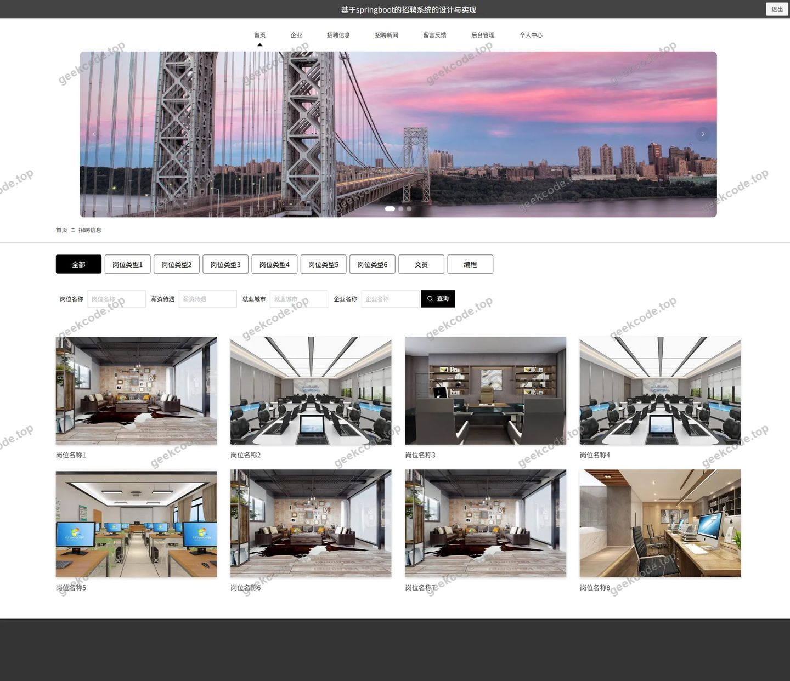</a>

<h4>前台-个人中心</h4>

<a href="https://geekcode.top/archives/%E5%9F%BA%E4%BA%8Espringboot%E7%9A%84%E6%8B%9B%E8%81%98%E7%B3%BB%E7%BB%9F%E7%9A%84%E8%AE%BE%E8%AE%A1%E4%B8%8E%E5%AE%9E%E7%8E%B0-%E8%AE%BA%E6%96%87?utm_source=github" title="查看完整源码">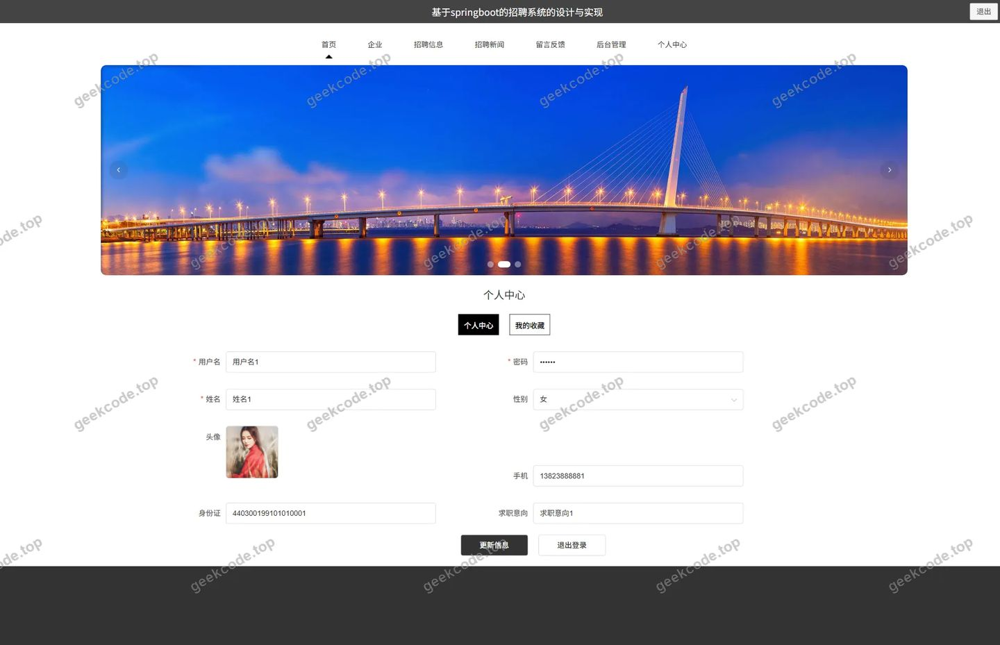</a>

<h4>前台-公告列表</h4>

<a href="https://geekcode.top/archives/%E5%9F%BA%E4%BA%8Espringboot%E7%9A%84%E6%8B%9B%E8%81%98%E7%B3%BB%E7%BB%9F%E7%9A%84%E8%AE%BE%E8%AE%A1%E4%B8%8E%E5%AE%9E%E7%8E%B0-%E8%AE%BA%E6%96%87?utm_source=github" title="查看完整源码">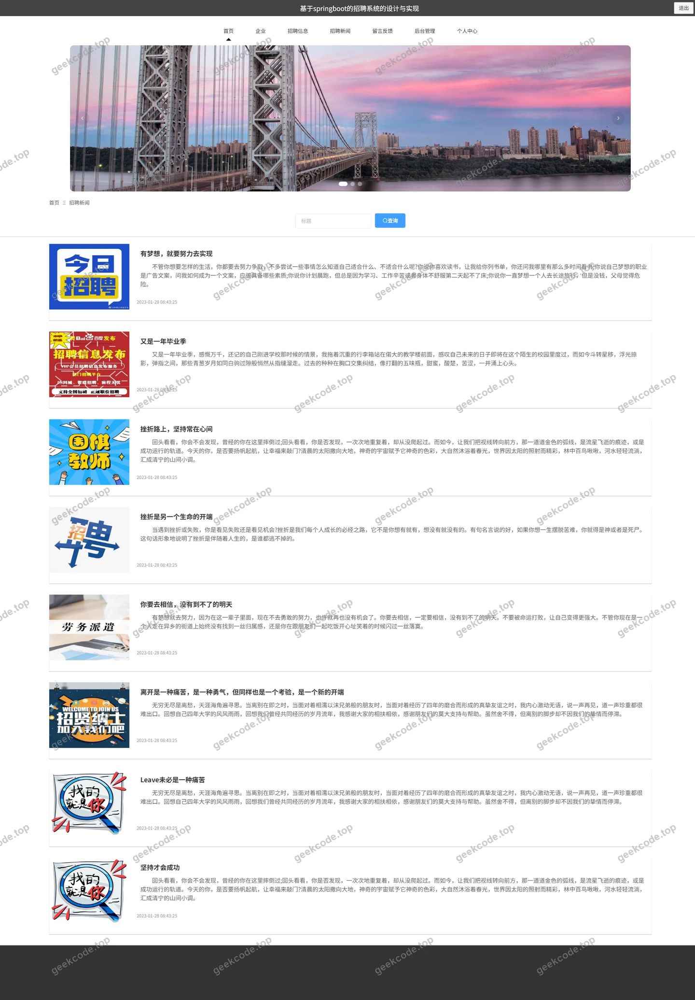</a>

<h3>后台管理端</h3>
<h4>后台-系统配置</h4>

<a href="https://geekcode.top/archives/%E5%9F%BA%E4%BA%8Espringboot%E7%9A%84%E6%8B%9B%E8%81%98%E7%B3%BB%E7%BB%9F%E7%9A%84%E8%AE%BE%E8%AE%A1%E4%B8%8E%E5%AE%9E%E7%8E%B0-%E8%AE%BA%E6%96%87?utm_source=github" title="查看完整源码">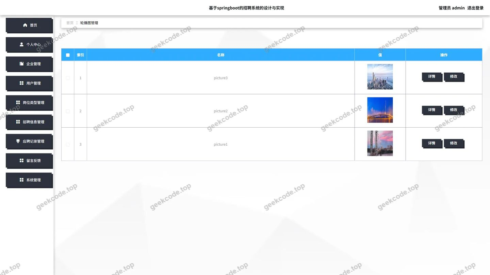</a>

<h4>后台-岗位类型</h4>

<a href="https://geekcode.top/archives/%E5%9F%BA%E4%BA%8Espringboot%E7%9A%84%E6%8B%9B%E8%81%98%E7%B3%BB%E7%BB%9F%E7%9A%84%E8%AE%BE%E8%AE%A1%E4%B8%8E%E5%AE%9E%E7%8E%B0-%E8%AE%BA%E6%96%87?utm_source=github" title="查看完整源码">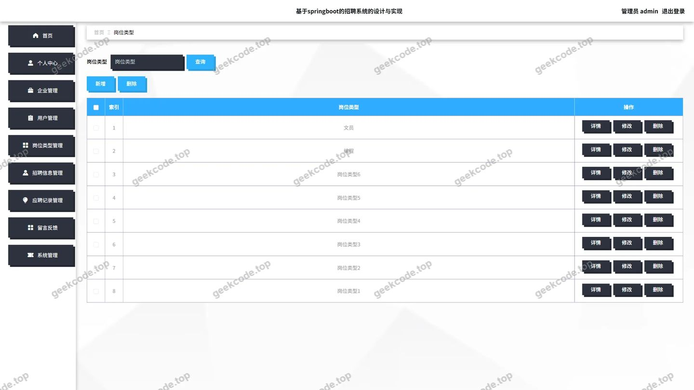</a>

<h4>后台首页</h4>

<a href="https://geekcode.top/archives/%E5%9F%BA%E4%BA%8Espringboot%E7%9A%84%E6%8B%9B%E8%81%98%E7%B3%BB%E7%BB%9F%E7%9A%84%E8%AE%BE%E8%AE%A1%E4%B8%8E%E5%AE%9E%E7%8E%B0-%E8%AE%BA%E6%96%87?utm_source=github" title="查看完整源码">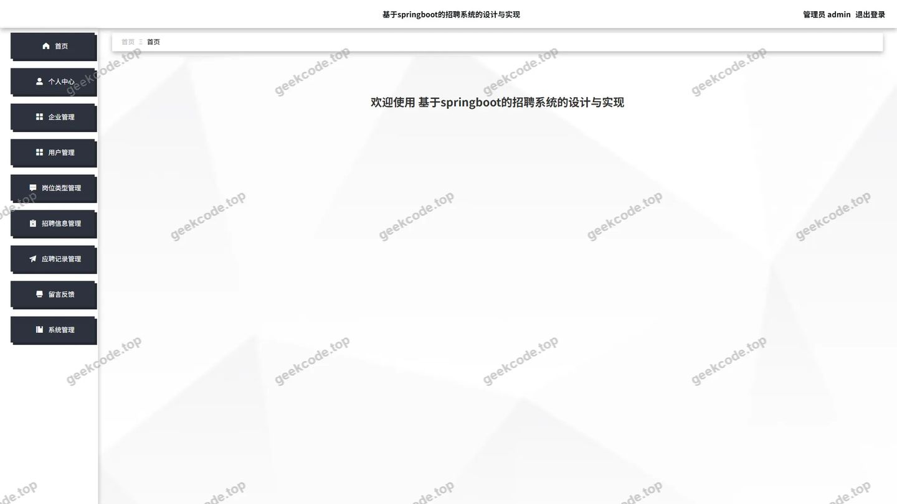</a>

<h4>后台-登录</h4>

<h4>后台-留言板</h4>

<a href="https://geekcode.top/archives/%E5%9F%BA%E4%BA%8Espringboot%E7%9A%84%E6%8B%9B%E8%81%98%E7%B3%BB%E7%BB%9F%E7%9A%84%E8%AE%BE%E8%AE%A1%E4%B8%8E%E5%AE%9E%E7%8E%B0-%E8%AE%BA%E6%96%87?utm_source=github" title="查看完整源码">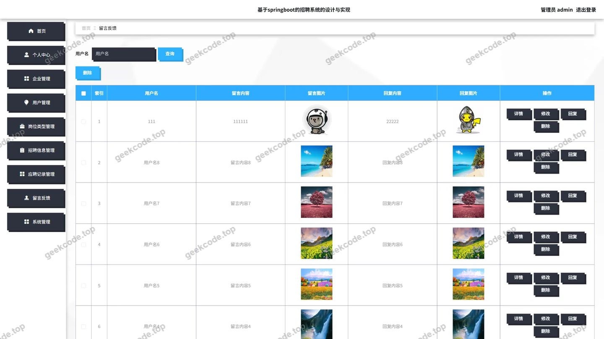</a>

<h4>后台-公告信息</h4>

<a href="https://geekcode.top/archives/%E5%9F%BA%E4%BA%8Espringboot%E7%9A%84%E6%8B%9B%E8%81%98%E7%B3%BB%E7%BB%9F%E7%9A%84%E8%AE%BE%E8%AE%A1%E4%B8%8E%E5%AE%9E%E7%8E%B0-%E8%AE%BA%E6%96%87?utm_source=github" title="查看完整源码">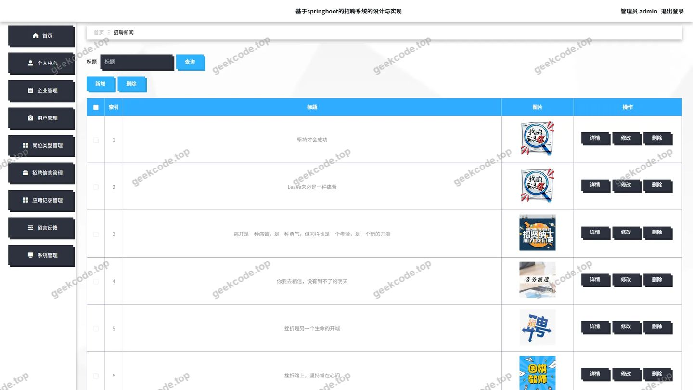</a>

<h4>后台-企业</h4>

<a href="https://geekcode.top/archives/%E5%9F%BA%E4%BA%8Espringboot%E7%9A%84%E6%8B%9B%E8%81%98%E7%B3%BB%E7%BB%9F%E7%9A%84%E8%AE%BE%E8%AE%A1%E4%B8%8E%E5%AE%9E%E7%8E%B0-%E8%AE%BA%E6%96%87?utm_source=github" title="查看完整源码">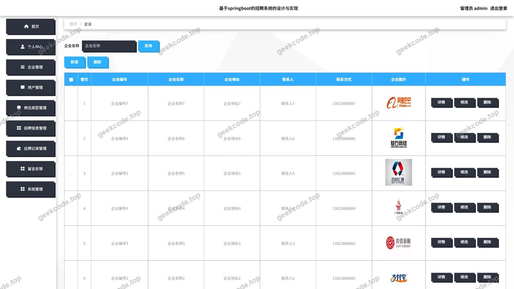</a>

<h4>后台-应聘记录</h4>

<a href="https://geekcode.top/archives/%E5%9F%BA%E4%BA%8Espringboot%E7%9A%84%E6%8B%9B%E8%81%98%E7%B3%BB%E7%BB%9F%E7%9A%84%E8%AE%BE%E8%AE%A1%E4%B8%8E%E5%AE%9E%E7%8E%B0-%E8%AE%BA%E6%96%87?utm_source=github" title="查看完整源码">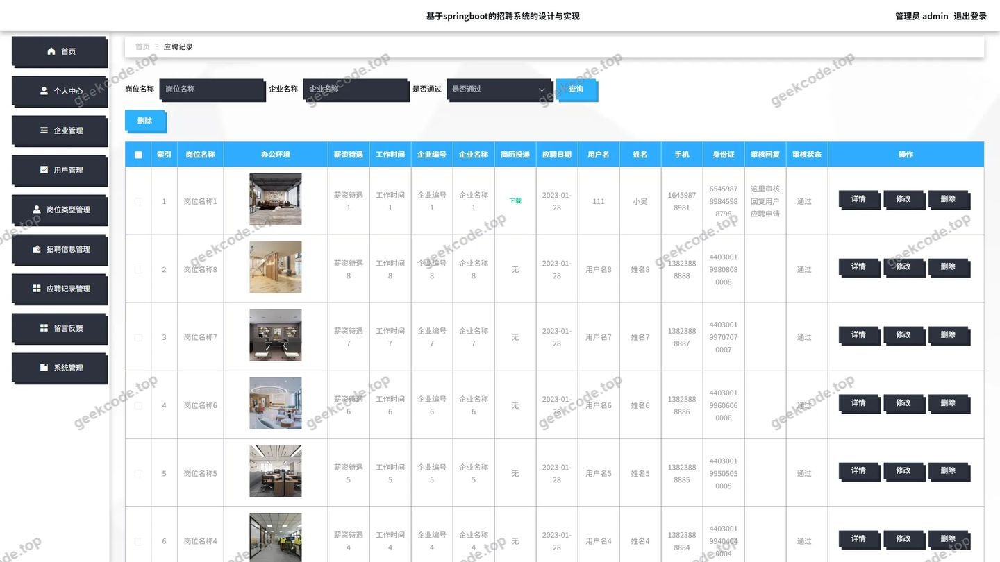</a>

<h4>后台-招聘信息</h4>

<a href="https://geekcode.top/archives/%E5%9F%BA%E4%BA%8Espringboot%E7%9A%84%E6%8B%9B%E8%81%98%E7%B3%BB%E7%BB%9F%E7%9A%84%E8%AE%BE%E8%AE%A1%E4%B8%8E%E5%AE%9E%E7%8E%B0-%E8%AE%BA%E6%96%87?utm_source=github" title="查看完整源码">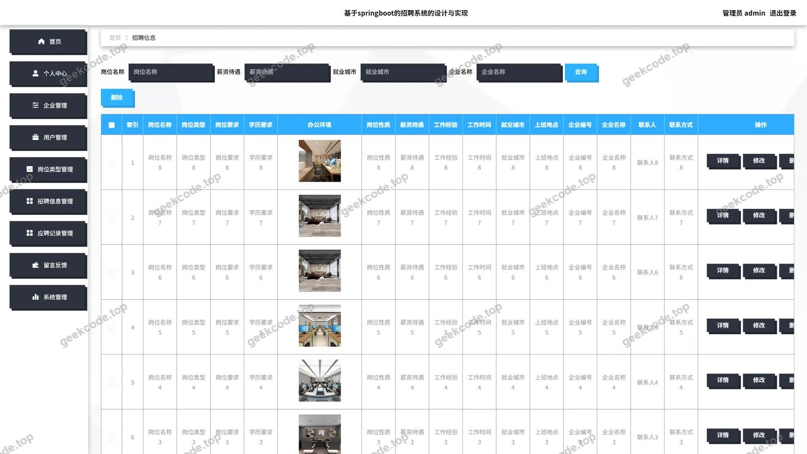</a>

---

## 获取完整源码

| 项目 | 说明 |
| --- | --- |
| 项目名 | 基于springboot的招聘系统的设计与实现--论文 |
| 运行截图 | 本文 18 张（站点带水印原图，仓库 `images/` 目录） |
| 完整源码 | [https://geekcode.top/archives/%E5%9F%BA%E4%BA%8Espringboot%E7%9A%84%E6%8B%9B%E8%81%98%E7%B3%BB%E7%BB%9F%E7%9A%84%E8%AE%BE%E8%AE%A1%E4%B8%8E%E5%AE%9E%E7%8E%B0-%E8%AE%BA%E6%96%87?utm_source=github](https://geekcode.top/archives/%E5%9F%BA%E4%BA%8Espringboot%E7%9A%84%E6%8B%9B%E8%81%98%E7%B3%BB%E7%BB%9F%E7%9A%84%E8%AE%BE%E8%AE%A1%E4%B8%8E%E5%AE%9E%E7%8E%B0-%E8%AE%BA%E6%96%87?utm_source=github) |
| 咨询微信 | **ir9372**（备注：jingpin-yuanma） |
| 更多项目 | [极客代码 geekcode.top](https://geekcode.top/?utm_source=github) |

> 需要源码、部署、改配置、跑不起来等问题，加微信 ir9372 沟通，说明项目名即可。
